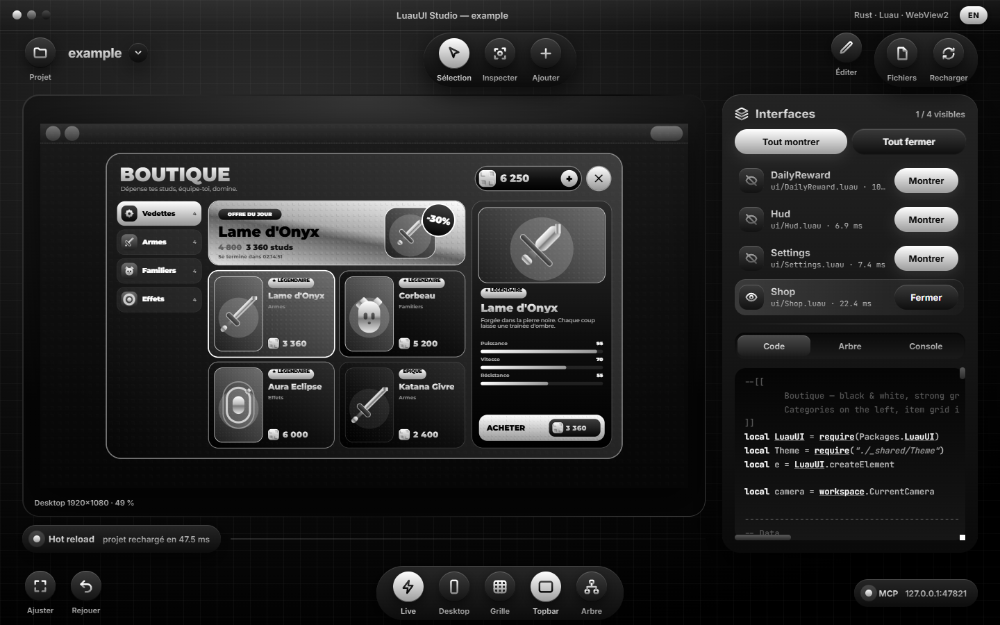

# LuauUI Studio

Aperçu en direct des interfaces Roblox écrites en Luau, sans passer par Roblox Studio.
C'est une app Rust native (tao + WebView2) qui exécute de vraies VM Luau (mlua) et recharge à chaque sauvegarde. Un rack liste toutes les UIs pour montrer ou fermer chacune, et un serveur MCP permet à Claude (ou à tout client MCP) d'écrire, rendre, cliquer et capturer les UIs.

[English](README.md)



## Fonctionnalités

- **Hot reload** : sauvegarder un fichier `.luau` le re-rend en 10 à 30 ms environ. Chaque fichier tourne dans sa propre VM Luau.
- **Rack des UIs** : chaque fichier `ui/**/*.luau` apparaît dans le panneau de droite avec **Montrer / Fermer**, plus **Tout montrer / Tout fermer**.
- **Les deux styles Roblox** : composants façon React/Roact (`LuauUI` / `React` / `Roact`, hooks, composants classe) et code impératif (`Instance.new` + `:Connect`).
- **Aperçu interactif** : boutons, TextBox, `useState`, `setState` et signaux connectés fonctionnent.
- **Mode Inspecter** (I) : survole un élément pour voir sa classe, son nom et sa taille ; clique pour voir ses propriétés dans l'onglet **Arbre**.
- **Appareils** : desktop, laptop, tablette, téléphone (paysage ou portrait), console. La barre Roblox de 58 px peut être affichée ou masquée.
- **Images** : les `rbxassetid://` sont téléchargées depuis Roblox et mises en cache ; les chemins relatifs (`assets/coin.png`) sont lus dans le dossier du projet.
- **Console** pour `print` / `warn`, et une carte sur l'aperçu pour les erreurs Luau.
- **Interface en anglais / français** (bouton EN/FR dans la barre de titre).

La liste complète de l'API supportée est dans [docs/API.md](docs/API.md) (en anglais).

## Compiler et lancer

Prérequis : Windows 10/11 (WebView2), Rust stable avec la toolchain MSVC.

```powershell
cargo build --release
.\target\release\luauui.exe .\example
```

L'argument est le dossier du projet, qui doit contenir `ui/`. Sans argument, l'app ouvre le dossier courant.

## Serveur MCP (Claude)

```powershell
claude mcp add luauui --scope user -- "C:\chemin\vers\LuauUI\target\release\luauui-mcp.exe"
```

Outils : `status`, `api_reference`, `list_uis`, `read_ui`, `write_ui`, `write_module`, `delete_ui`, `render`, `show_ui`, `hide_ui`, `show_all`, `hide_all`, `set_device`, `get_layout`, `screenshot`, `click`, `type_text`, `reset_ui`, `launch_app`, `open_project`, `init_project`.

## Limites

- L'aperçu montre une seule image : les tweens et `task.delay` sautent à leur état final, Heartbeat et RenderStepped ne se déclenchent jamais.
- La 3D, le contenu des ViewportFrame et le placement dans le monde des BillboardGui / SurfaceGui ne sont pas simulés.
- La capture d'écran demande que la fenêtre soit ouverte et non réduite.

## Crédits

Les textures de studs dans `example/assets` viennent de [ui-resources.com](https://ui-resources.com) (Textures › Stud). Vérifie les conditions de leur créateur avant de les réutiliser dans un jeu publié.
