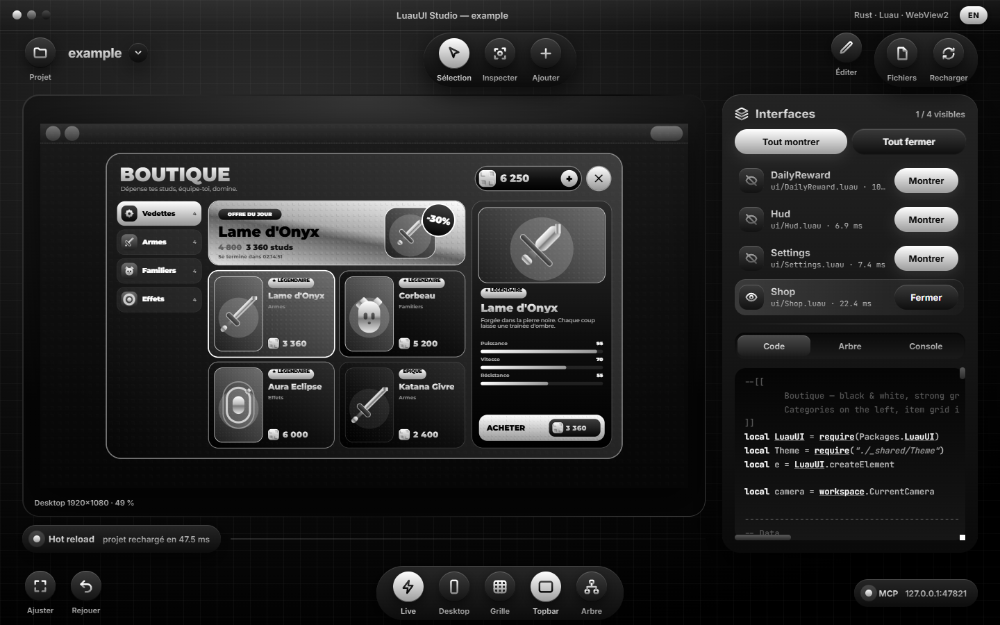
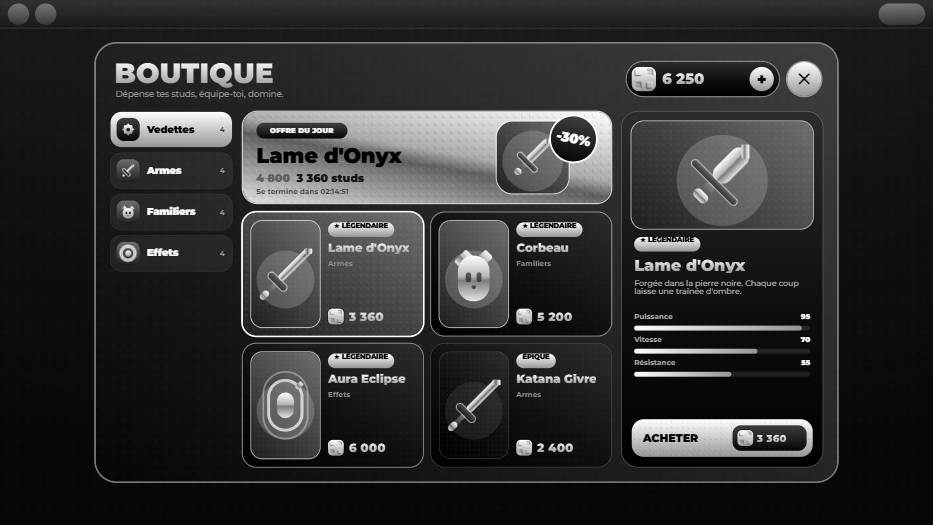

# LuauUI Studio

Live preview for Roblox interfaces written in Luau, outside Roblox Studio.
It is a native Rust app (tao + WebView2) that runs real Luau VMs (mlua) and hot reloads on every save. A rack lists every UI so you can show or close each one, and an MCP server lets Claude (or any MCP client) write, render, click and screenshot UIs.

[Français](README.fr.md)



## Features

- **Hot reload**: saving a `.luau` file re-renders it in about 10–30 ms. Each file runs in its own Luau VM.
- **UI rack**: every `ui/**/*.luau` file shows up in the right-hand panel with **Show / Close**, plus **Show all / Close all**.
- **Both Roblox UI styles**: React/Roact-like components (`LuauUI` / `React` / `Roact`, hooks, class components) and imperative code (`Instance.new` + `:Connect`).
- **Interactive preview**: buttons, TextBox, `useState`, `setState` and connected signals work.
- **Inspect mode** (I): hover an element to see its class, name and size; click it to see its properties in the **Tree** tab.
- **Devices**: desktop, laptop, tablet, phone (landscape or portrait), or console. The 58 px Roblox top bar can be shown or hidden.
- **Images**: `rbxassetid://` images are fetched from Roblox and cached; relative paths (`assets/coin.png`) are read from the project folder.
- **Console** for `print` / `warn`, and a card on the preview for Luau errors.
- **English / French interface** (EN/FR button in the title bar).

The full list of supported API is in [docs/API.md](docs/API.md).



## Build and run

Requirements: Windows 10/11 (WebView2), Rust stable with the MSVC toolchain.

```powershell
cargo build --release
.\target\release\luauui.exe .\example
```

The argument is the project folder, which must contain `ui/`. Without an argument, the app uses the current folder.

## Project layout

```
my-project/
  luauui.json          optional: { "uiDir": "ui" }
  ui/
    Shop.luau          one UI = one file in the rack
    menus/Settings.luau
    _shared/Theme.luau files/folders starting with _ are shared modules, not UIs
  assets/              images referenced with relative paths
```

A UI module returns a component function, an element, an Instance (ScreenGui), or a story table. You can also mount into `PlayerGui`. Modules are loaded with `require(script.Parent._shared.Theme)`, `require("./_shared/Theme")` or `require(game.ReplicatedStorage.X)`.

## MCP server (Claude)

`luauui-mcp.exe` is an MCP server over stdio. To register it in Claude Code:

```powershell
claude mcp add luauui --scope user -- "C:\path\to\LuauUI\target\release\luauui-mcp.exe"
```

Tools: `status`, `api_reference`, `list_uis`, `read_ui`, `write_ui` (writes, reloads, and returns the tree, errors and layout overflows), `write_module`, `delete_ui`, `render` (headless when the app is closed), `show_ui`, `hide_ui`, `show_all`, `hide_all`, `set_device`, `get_layout`, `screenshot` (PNG of the preview), `click`, `type_text`, `reset_ui`, `launch_app`, `open_project`, `init_project`.

The app exposes a local HTTP API on `127.0.0.1:47821`, which the MCP server uses: `/state`, `/tree`, `/show`, `/hide`, `/only`, `/fire`, `/layout`, `/screenshot`, …

## Source layout

```
src/prelude.luau   Roblox API emulation + LuauUI library (React-like) + serialization
src/runtime.rs     Luau VM per file, sandboxed require, 2 s time limit
src/project.rs     UI discovery, templates, devices, tree outline
src/bin/app.rs     window, file watcher, IPC, HTTP API, screenshot
src/ui/index.html  interface + renderer from the Roblox tree to the DOM
src/bin/mcp.rs     MCP server
example/           example project (HUD, Shop, DailyReward, Settings)
```

## Limits

- The preview shows a single frame: tweens and `task.delay` jump to their end state, and Heartbeat / RenderStepped never fire.
- 3D objects, ViewportFrame content and world placement of BillboardGui / SurfaceGui are not simulated.
- Screenshots need the window to be open and not minimized.

## Credits

Stud textures in `example/assets` come from [ui-resources.com](https://ui-resources.com) (Textures › Stud). Check the original creator's terms before reusing them in a published game.
